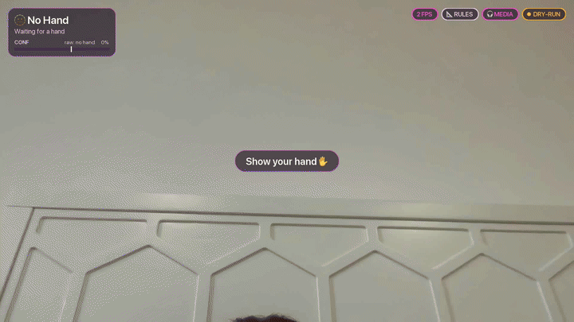

# Hand Gesture Recognition — Syntecxhub AI Internship, Project 2



<!-- Regenerate the GIF: python demo.py --dry-run --record demo.mp4  then  python tools/make_gif.py -->

**Try it in your browser:** the [`web/`](web/) version runs entirely on your device. See [Browser version](#browser-version) below.

Real-time hand gesture recognition from a webcam using **MediaPipe Hand Landmarker** and **OpenCV**. Recognised gestures are mapped to actions in three switchable modes: **media** (play/pause, volume, tracks, plus a pinch volume slider), **slides** (next/previous slide, start presentation) and **mouse** (a virtual mouse: move, click, drag, scroll). Swipes and a two-hand exit gesture work on top of the static poses. All mappings live in `config.yaml`.

## How it works

1. **Hand tracking** (`gesture/hand_tracker.py`): MediaPipe Tasks `HandLandmarker` in VIDEO mode finds 21 landmarks for up to two hands per frame. The first detected hand drives the controls. The model file downloads automatically the first time you run it.
2. **Classification** (`gesture/classifier.py`): a rule-based classifier decides which fingers are extended, then matches the pattern (see [How the classifier reads a hand](#how-the-classifier-reads-a-hand)). It works for both hands and for upright, tilted or sideways hands. The thumb's direction tells thumbs up from thumbs down.
3. **Smoothing**: finger-state hysteresis plus a 7-frame majority vote (60% must agree) stop flicker from triggering anything.
4. **Motion and continuous controls** (`gesture/motion.py`): the swipe detector, pinch volume slider, virtual mouse and two-hand exit. They follow landmarks over time, while `classifier.py` stays for static poses.
5. **Actions** (`gesture/actions.py`): stable gestures trigger the binding for the current mode from `config.yaml`. That can be an OS key sent through `pynput` or a built-in command. There is a 1 s cooldown between different actions. Gestures marked `repeat` fire again while you hold them.

Press `m` to cycle modes. The current mode is shown as a badge at the top right.

| Gesture | Fingers | Media mode | Slides mode | Mouse mode |
|---|---|---|---|---|
| ✋ Open palm | all five, held still | Play / Pause | F5 (start presentation) | – |
| ✊ Fist | none | Mute | – | – |
| 👍 Thumbs up | thumb, pointing up | Volume + (repeats) | – | – |
| 👎 Thumbs down | thumb, pointing down | Volume − (repeats) | – | – |
| ✌️ Peace | index + middle | Next track | → Right arrow (next slide) | – |
| ☝️ Pointing | index only | Previous track | ← Left arrow (previous slide) | – |
| 👉 Swipe right | open palm moved quickly right | Next track | → Next slide | – |
| 👈 Swipe left | open palm moved quickly left | Previous track | ← Previous slide | – |
| 🤟 / 🤘 Rock | index + pinky up, middle + ring down (thumb out 🤟 or tucked 🤘) | Toggle dry-run / live | same | same |
| 👌 OK | thumb tip touches index tip, other three up | Screenshot to `~/Desktop/gesture_<timestamp>.png` | same | same |
| 🤙 Call me | thumb + pinky | Open Spotify (falls back to music.youtube.com) | same | same |

Rock, OK and Call me are **global** bindings, so they work in every mode. A mode can override or disable one (`ok: null`).

How the similar gestures are told apart:
- **Rock vs Call me vs Pointing:** rock is index + pinky up (any thumb). Call me is thumb + pinky up with the index down. Pointing has the pinky down, so pointing with the thumb out is still pointing.
- **OK vs Open palm:** OK is checked first. It needs the thumb and index tips closer than `pinch.ok_ratio` × palm size (default 0.25). In an open palm those tips are always far apart.

### How the classifier reads a hand

Each finger is **extended**, **curled** or **ambiguous**, judged from two cues:
- the bend at its middle joint (the 3-D MCP–PIP–DIP angle): a straight finger is about 160–180°, a curled one under 120°
- its *reach*: wrist→tip over wrist→PIP

The angle is what makes sideways hands work. A finger pointing sideways is still straight, even when its tip is barely further from the wrist than its knuckle. The thumb counts as extended when it's straight and points away from the palm.

- **Hysteresis:** becoming extended and becoming curled need different evidence. An ambiguous finger keeps its state from the last frame, so a slightly bent ring finger doesn't make ✌️ flicker.
- **No history** (e.g. a single test frame): an ambiguous finger is resolved both ways, and the pose is only named if both give the same gesture. Otherwise it's `unknown`.
- **Fist safety:** ✊ needs all four fingers *clearly* curled *and* a tucked thumb (near the wrist, pointing back toward the palm, or resting on the fingers), so an unclear hand never fires Mute.
- **Thumbs up / down** have their own tests, measured on real photos:
  - **direction:** the thumb's angle from vertical (thumb MCP → tip). It enters within **50°** and stays until **70°** (hysteresis), so a tilted thumb doesn't drop out.
  - **fingers:** each curled, or half-bent but short (a loose fist). None may be clearly extended.
  - **thumb:** it has to stick clearly out of the fist; a slight bend is fine.
  - **hold-through:** a confirmed thumbs pose survives up to **0.3 s** of unknown frames, so the volume repeat keeps going. Any other confirmed gesture ends it immediately.
  - Thumbs poses never start pinch mode and never read as fist or call me.
- **Aspect ratio:** MediaPipe normalises x by the frame *width* and y by its *height*. Classification therefore uses `Hand.iso`, with x and z scaled by width/height, so angles and distances are true to the image.

### What you see on your hand

Each gesture has its own accent colour, used by the skeleton glow, the hand box and the tag. It fades over 150 ms when the gesture changes:

| ✋ palm | ✊ fist | 👍 up | 👎 down | ✌️ peace | ☝️ pointing | 🤟 rock | 👌 ok | 🤙 call me |
|---|---|---|---|---|---|---|---|---|
| pink | red | green | orange | cyan | purple | magenta | yellow | teal |

- **Hold-to-fire ring** around the emoji on the hand tag. It fills as the smoother collects votes for the gesture, and reaches 100% exactly when the gesture is confirmed. It flashes and pops when the action fires, so you can see when something is about to happen.
- **Big emoji pop** (~120 px) above the hand when a *new* gesture is confirmed. It scales 0.6 → 1.1 → 1.0 and fades out over 0.8 s.
- **Finger highlights:** fingertips the classifier sees as extended are bigger and brighter with a halo. Curled ones are small and dim.
- **Smooth tag and box:** both follow the hand with an EMA instead of jumping. They stay inside the frame and never draw over the HUD, legend or other panels.
- **Action pill** (e.g. `⏭ Next track`) floats up from the hand when an action fires, in addition to the centre toast.
- **Volume meter** next to the hand while 👍/👎 is held. It ticks one step per repeat. The level is an estimate, because the system volume isn't read back; the pinch slider resets it to the real value.
- **Unknown pose:** a dashed grey box and a muted `…` tag instead of "🤔 Unknown".
- **HUD:** shows the gesture, its action, the confidence bar and the **last 3 fired actions** as chips. The raw per-frame label is only in the `g` debug card.

All of this is drawn from cached cards and emoji sprites, with no font loading per frame. That's about 2 ms per frame at 1080p for one hand, and about 3 ms for two hands with every effect active.

### Debugging a pose: `g` and `p`

- **`g`** toggles a debug card that shows:
  - the per-finger states as `T I M R P` = 1/0, with `?` for ambiguous
  - the thumb angle, its away-from-palm ratio and its distance from the index knuckle
  - the thumb–index pinch distance
  - each finger's angle and reach
  - **which rule rejected the pose**, e.g. `blocked: open_palm (thumb up)`

  Fingertips get rings: green extended, grey curled, amber ambiguous.
- **`p`** freezes the current hand and asks for the expected label: press `1`–`9`, or `0` for unknown (`Esc` cancels). The landmarks, the label and what the rules said are appended to `tests/fixtures/real_hands.json` (or `--fixtures path`). `tests/test_real_hands.py` then checks every saved hand on each test run, so a misread pose becomes a regression test.

The file starts with five real hands taken from MediaPipe's sample photos (landmarks only). One of them is the open palm whose straight, spread thumb tip was only 0.48 palm-widths from the index knuckle. The old rule required more than 0.55 and returned `unknown`.

### Motion and continuous controls

| Control | How | Where |
|---|---|---|
| 👉👈 **Swipe** | Open palm moved horizontally more than 25% of the frame width within about 0.4 s, with vertical drift under half of that. 1 s cooldown. | modes that bind `swipe_left` / `swipe_right` (media, slides) |
| 🤏 **Pinch volume slider** | Thumb + index only, other fingers curled. Thumb–index distance (in palm sizes) maps to 0–100 volume, smoothed, and sent only when it changes by 3 or more. A vertical volume bar is shown while you pinch. On macOS it uses `osascript -e "set volume output volume N"`; other systems are skipped. | media |
| ☝️ **Move cursor** | The index fingertip moves the cursor. The centre 60% of the frame (dashed box) maps to the full screen, smoothed with an EMA (`mouse.alpha`). | mouse |
| 🤏 **Click / drag** | Thumb tip to index tip under `pinch.click_ratio` × palm size presses the left button, and opening releases it. A quick pinch is a click; hold and move to drag. Hysteresis, a 0.3 s debounce and a 0.15 s cursor freeze on press keep clicks on target. | mouse |
| ✌️ **Scroll** | Peace pose, then move your hand up or down. | mouse |
| ✋✋ **Quit** | Both hands open palm for 1 s. A countdown ring fills in the centre. | all |

How the controls avoid clashing:
- **Swipe vs ✋ Play/Pause:** the static open-palm action only fires once the palm has been still for 0.3 s (`swipe.still_hold`). After a swipe it is blocked until the pose changes, so a swipe never also toggles playback.
- **Pinch mode owns the hand.** While it's active:
  - the HUD and hand tag show **🤏 Pinch → Volume N%**, and the tag's ring shows the level
  - every static action and swipe is blocked; the L-shape classifies as ☝️ but can't fire Previous track
  - only the volume bar changes in DRY-RUN

  Mode starts after 2 pinch frames, though actions are blocked from the first one. It survives brief misreads for 0.3 s. When it ends, the smoother is cleared, so the pinch's leftover "pointing" can't fire on exit. A real ☝️ afterwards just needs its normal hold.
- **Pinch slider vs ☝️ Pointing:** the slider needs the thumb out, or near the index tip. Pointing with the thumb tucked is still "previous track". In media mode the L-shape (thumb + index out) is the volume slider.
- **Click vs 👌 / ✊:** a pinch with middle, ring and pinky all up is 👌 (screenshot), not a click. A fist doesn't count either: the index tip must reach more than one palm size from the wrist.
- **While both palms are open** for the exit gesture, no other actions fire.

The screen size comes from Quartz on macOS, with pyautogui as the fallback. Dry-run shows the cursor, volume bar and clicks on screen without moving the real mouse or changing the volume.

## Configuration (`config.yaml`)

```yaml
default_mode: media
global:                     # active in every mode
  ok: {command: screenshot, label: "Screenshot"}
modes:
  slides:
    peace: {key: right, label: "Next slide"}
    open_palm: {keys: [cmd, shift, enter], label: "Play (PowerPoint for Mac)"}  # key combos work too
cooldowns: {action: 1.0, repeat_interval: 0.35}
smoothing: {window: 7, min_ratio: 0.6}
pinch: {ok_ratio: 0.25, click_ratio: 0.30, release_factor: 1.4}
swipe: {window: 0.4, min_travel: 0.25, max_vertical_ratio: 0.5, cooldown: 1.0, still_hold: 0.3}
volume: {modes: [media], min_ratio: 0.25, max_ratio: 1.10, step: 3, alpha: 0.4}
mouse: {alpha: 0.35, box: 0.6, click_debounce: 0.3, click_freeze: 0.15, scroll_gain: 25}
exit: {hold: 1.0}
```

A binding is one of:
- `key:` a [pynput `Key`](https://pynput.readthedocs.io/en/latest/keyboard.html#pynput.keyboard.Key) name or a single character
- `keys:` a list of keys pressed as a combo
- `command:` one of `toggle_dry_run`, `screenshot` or `open_spotify`

Add `repeat: true` to make a binding fire again while held. The file is checked at startup, and mistakes are reported with the line's path (e.g. `modes.slides.peace`). To use a different file, pass `--config path.yaml` or set `GESTURE_CONFIG`.

## Setup

```bash
python -m venv venv
venv\Scripts\activate            # Windows   (macOS/Linux: source venv/bin/activate)
pip install -r requirements.txt
```

## Run the demo

```bash
python demo.py --dry-run         # safe: shows actions on screen, no key presses
python demo.py                   # live: really controls media playback
python demo.py --camera 1        # use a different webcam
python demo.py --record demo.mp4 # save the annotated video
python demo.py --video clip.mp4  # run on a video file instead of the webcam
python demo.py --mode slides     # start in slides mode
python demo.py --config my.yaml  # use a different config file
```

In-window keys: `q`/`Esc` quits, `m` cycles the mode (media → slides → mouse), `d` switches dry-run on/off, `h` shows/hides the gesture legend (hidden by default), `g` toggles the classifier debug card, and `p` saves the current hand as a test fixture.

The drawing cost is about 2.5 ms per frame at 1080p. That comes from:
- each panel being a cached card, rebuilt only when its text changes
- the skeleton glow being blurred at quarter resolution, only around the hand

Hand detection (about 20 ms) is now the main per-frame cost, which leaves room for 25+ FPS.

Dry-run skips every side effect: no key presses, screenshots or app launches. Only 🤟 rock (toggle dry-run) still works.

> **macOS permissions** (System Settings → Privacy & Security), for the terminal/app that runs `python`:
> - **Camera**: needed to see your hand.
> - **Accessibility**: needed for real key presses (media/slides) **and for the virtual mouse** (moving, clicking, scrolling). Without it, pynput's events are silently ignored.
> - **Screen Recording**: needed for the 👌 screenshot.
>
> On other systems the screenshot uses `pyautogui`, which is installed automatically everywhere except macOS.

## ML Classifier

The rule-based classifier can be swapped for a model trained on your own hand. All three stages share one feature pipeline, `gesture/features.py`, so collection, training and live inference see identical inputs:
- translate so the wrist is at the origin
- scale by palm size (wrist → middle-finger MCP)
- flatten the 21 × (x, y, z) landmarks to 63 numbers
- add handedness (+1 right, −1 left), for 64 features in total

### 1. Collect data

**Recommended: guided mode.** This records every gesture in one session:

```bash
python collect_data.py --guided                      # 200 samples per gesture -> data/landmarks.csv
python collect_data.py --guided --per-gesture 120 --mirror-augment
```

It walks through `open_palm, fist, thumbs_up, thumbs_down, peace, pointing, rock, ok, call_me` and finally `unknown`. For `unknown`, make relaxed, half-curled and random poses, which become the negative class. For each gesture:

1. A big card shows the emoji, the name and a short "how to do it" hint, plus `Gesture 3/10`.
2. A **3-2-1** countdown runs, then recording starts automatically whenever a hand is visible, until it has `--per-gesture` samples. A progress bar fills as it goes.
3. Halfway through, the card says **"Now vary it: move closer / further, tilt your hand, switch hands"**.

| Key | Does |
|---|---|
| `SPACE` | pause / resume (the countdown freezes too) |
| `s` | skip this gesture; samples it already has are kept |
| `r` | redo this gesture; its rows from this session are discarded |
| `q` / `Esc` | save and quit, including the current gesture's partial samples |

At the end it prints a table of samples (and rows) per gesture, with the total.

How the samples are kept varied and usable:
- **At most ~10 samples/s** (`--rate`), and **near-duplicate frames are skipped**: if the normalised landmarks barely moved since the last sample, the frame is ignored. A frozen hand doesn't produce 200 identical rows.
- **Rows are written when a gesture finishes**, or on skip or quit. That's what lets `r` discard them without editing the CSV.
- **Each gesture is split into 5 takes**, and a pause starts a new one. `train.py` can then hold out whole takes instead of near-identical neighbouring frames.
- `--mirror-augment` still adds an x-flipped copy of every sample. It counts as the same sample, so a gesture still stops at N.

**Manual mode** gives you full control over each recording:

```bash
python collect_data.py                    # appends to data/landmarks.csv
python collect_data.py --mirror-augment   # also store an x-flipped (other-hand) copy of each sample
```

| Key | Does |
|---|---|
| `1`–`9` | choose the label: 1 open_palm, 2 fist, 3 thumbs_up, 4 thumbs_down, 5 peace, 6 pointing, 7 rock, 8 ok, 9 call_me |
| `0` | `unknown`: any other pose, so the model learns to reject |
| hold `SPACE` | record. One hold is one *take*. |
| `r` | toggle recording without holding SPACE |
| `q` / `Esc` | quit |

The right-hand panel shows a live sample count per label. Each CSV row stores:
- the label, handedness, sample/take ids and a timestamp
- the 64 normalised features
- the 63 raw landmark values, so `evaluate.py` can run the rule-based classifier on exactly the same samples

Recording is capped at 15 samples/s (`--rate`).

For a good dataset:
- aim for **several short takes per gesture (5 or more)** rather than one long one
- vary distance, angle, lighting and both hands between takes
- record some `0 / unknown` (relaxed and in-between poses)

> OpenCV has no key-up events, so "hold SPACE" relies on keyboard auto-repeat. If your repeat delay is long, use `r` instead.

### 2. Train

```bash
python train.py            # --data data/landmarks.csv --model models/gesture_model.joblib --reports reports
```

This trains a **RandomForest** and an **MLP** (StandardScaler + 128-64 hidden units) on a stratified 80/20 split. For each one it prints accuracy, macro F1 and a classification report, and it saves the confusion matrices to `reports/confusion_<model>.png`. The model with the best macro F1 is saved to `models/gesture_model.joblib` with its label list, together with the other model and the test sample ids.

**The split keeps near-duplicates apart.** Consecutive frames in one take are almost identical, and so are a sample and its mirrored copy. A row-level split would put near-copies in both train and test and overstate the scores. So when every label has at least 5 takes, whole takes go to one side (`StratifiedGroupKFold`). Otherwise it splits by sample, keeping each sample with its mirrored copy, and the report says so.

### 3. Evaluate: rules vs RandomForest vs MLP

```bash
python evaluate.py         # -> reports/comparison.md
```

This runs the rule-based `classify()` (on the saved raw landmarks) and both ML models on **the same held-out test samples** chosen by `train.py`. It prints and saves a table of accuracy, macro F1 and inference time per sample (one sample at a time, as in the live demo), plus per-label accuracy. On a synthetic test set the rules take about 0.002 ms per sample, the MLP about 0.1 ms and the RandomForest about 4 ms, which is all well within a 30 fps frame budget. Re-run on your own data for real numbers.

### 4. Use it live

```bash
python demo.py --classifier ml              # or --model path/to/model.joblib
```

The model's `predict_proba` is used, and a pose comes out as `unknown` when the top probability is below `ml.min_confidence` (0.6) in `config.yaml`. Smoothing, modes, swipes and the mouse work the same with either classifier. The FPS badge shows `RULES` or `ML`.

## Browser version

`web/` is a no-build port of the demo that runs entirely in the browser:
- Hand tracking uses `@mediapipe/tasks-vision`, pinned to **1.1.1** and loaded from the jsDelivr CDN, with the versioned hand-landmarker model (`float16/1`).
- The webcam comes through `getUserMedia`.
- The rule-based classifier is ported to [`web/classifier.js`](web/classifier.js) with the same rules and the same order of checks as `gesture/classifier.py`, along with the 7-frame smoother and the cooldown/repeat dispatcher. A parity test (`tests/test_web_parity.py`) runs Python and JS on the same ~2,000 synthetic hands and fails on any difference.

A web page can't press OS media keys, so gestures control a small demo `<audio>` player instead:

| Gesture | Browser action |
|---|---|
| ✋ Open palm | Play / Pause |
| ✊ Fist | Mute / unmute |
| 👍 / 👎 Thumbs up / down | Volume ± 10% (repeats while held) |
| ✌️ Peace | Next track |
| ☝️ Pointing | Previous track |

🤟 👌 🤙 are recognised and shown, but their actions (dry-run toggle, screenshot, Spotify) only exist in the desktop app.

The playlist is three short original loops **synthesised in the browser** as WAV, so there are no audio files or licences to worry about. The page has the same pink-purple glass style as the desktop app:
- the gesture HUD with its confidence bar
- FPS / RULES / MEDIA badges
- the legend (`h` toggles it)
- action toasts that fade over about 1 s
- a pulse ring at the palm
- a "Show your hand ✋" hint
- a glowing gradient skeleton with a tagged hand box

Video is processed locally and never uploaded.

### Run it locally

The camera only works on a secure origin, and `localhost` counts:

```bash
python -m http.server 8000 -d web
# open http://localhost:8000 and click "Start camera"
```

### Deploy to GitHub Pages

The workflow [`.github/workflows/pages.yml`](.github/workflows/pages.yml) publishes `web/` on every push to `main` that changes it. There's no build step.

1. Push the project to a GitHub repository with `main` as the default branch:
   ```bash
   git init && git add . && git commit -m "Hand gesture recognition"
   git branch -M main
   git remote add origin https://github.com/<you>/<repo>.git
   git push -u origin main
   ```
2. On GitHub, go to **Settings → Pages → Build and deployment → Source** and choose **GitHub Actions**.
3. Open the **Actions** tab. The "Deploy web demo to GitHub Pages" run publishes the site (re-run it if it started before step 2). It will be at `https://<you>.github.io/<repo>/`.

Pages is served over HTTPS, so the webcam works there. All paths in `web/` are relative, so the site also works under the `/<repo>/` sub-path. A deploy through Actions never runs Jekyll. `web/.nojekyll` is only there in case you publish from a branch instead.

## Demo GIF

```bash
python demo.py --dry-run --record demo.mp4     # record a short run (q to stop)
python tools/make_gif.py                       # -> docs/demo.gif (12 fps, 720 px wide, < 10 MB)
python tools/make_gif.py demo.mp4 --start 2 --duration 12   # trim
```

`tools/make_gif.py` uses **ffmpeg** when it's installed (`brew install ffmpeg`), with a two-pass palette for the best quality per MB. Otherwise it falls back to **OpenCV + Pillow**, which are already dependencies. If the result is over `--max-mb`, it retries with fewer colours, then a lower frame rate, then a smaller width. GIF delays are stored in 1/100 s, so for 12 fps it alternates 80 ms and 90 ms frames to keep the playback speed exact.

## Tests

```bash
python -m pytest -q
```

225 tests, mostly on synthetic landmarks, trajectories and video, so they need no webcam, model, mouse or speakers. They cover:
- every gesture, including rock, OK and call me, on both hands and at ±25° rotation
- the look-alike pairs (rock / call me / pointing, OK / open palm), and 🤘 horns as rock
- the live display helpers (`tests/test_display.py`):
  - the gesture colour map and the 150 ms fade
  - hold-ring progress, checked against the real smoother: it reaches 100% exactly when the gesture is confirmed
  - box/tag EMA smoothing and jitter reduction
  - tag placement that stays in the frame and avoids panels
  - the pop/float/flash curves, action icons and the volume meter
- pinch mode (`tests/test_pinch_mode.py`):
  - pointing (and every other action) never fires while pinch mode is active, nor on the frame it ends
  - the volume goes 100% (wide) → 0% (touching) smoothly, and the OS is only told about changes of 3 or more
  - the pinch pose holds across the whole gap on both hands
  - one-frame debounce, the 0.3 s exit grace, and pinch being off outside volume modes
- guided collection (`tests/test_guided.py`):
  - the gesture order and hints, and a full 10-gesture run
  - the 3-2-1 countdown
  - the ~10/s rate limit and near-duplicate skipping
  - the 50% tip
  - skip (keeps partial rows), redo (discards only the current gesture's rows), pause (freezes countdown and recording), quit (saves the partial gesture)
  - 5 takes per gesture, mirror-augment counting, and the summary table
  - valid CSV rows end to end
- thumbs (`tests/test_thumbs.py`):
  - real and synthetic thumbs tilted to ±40° (whole hand and thumb only) stay thumbs
  - the 50°/70° hysteresis
  - a loose fist with the thumb out, and a bent thumb
  - hold-through bridges dropouts so the volume repeat isn't interrupted (and without it, the repeat stalls)
  - an up→down switch flips cleanly with no Mute
  - thumbs never read as pinch, fist or call me
- live-testing regressions (`tests/test_classifier_v2.py`):
  - an open palm with a real-proportioned spread thumb (was `unknown`)
  - a sideways pointing finger (was `fist`)
  - a half-bent finger, which is `unknown` and never `fist`
  - ±60–90° rotations
  - ring-finger wobble that stays ✌️ with hysteresis
  - 16:9 aspect correction and the 0.6 smoother threshold
- real hands (`tests/test_real_hands.py`): every sample in `tests/fixtures/real_hands.json`, skipped if the file is missing
- the configurable pinch threshold
- the smoother and the action cooldown and repeat logic
- config loading and validation
- mode cycling
- live slide keys, using a fake keyboard
- the dry-run toggle
- the screenshot and Spotify commands, with the system calls mocked
- swipes (`tests/test_motion.py`): fast vs slow, too short, too diagonal, wrong pose, motion-blur tolerance, cooldown, and the gate that keeps ✋ from firing during a swipe
- the pinch distance → volume mapping, the 3-step threshold and smoothing, and the pinch-pose rules
- virtual-mouse logic: the centre-box → screen mapping, EMA smoothing, cursor movement, click debounce, drag, scroll, and that 👌 and ✊ are not clicks
- the two-hand exit hold timer
- ML features (`tests/test_ml.py`): translation and scale invariance, wrist at the origin, unit palm, mirroring, CSV round-trip
- the browser classifier (`tests/test_web_parity.py`): `web/classifier.js` must match Python on ~2,000 synthetic, jittered and real hands. That covers the gesture *and* each finger's extended/curled/ambiguous state, the hysteresis tracker on random hand sequences, and the smoother and dispatcher. Needs Node.js; skipped if `node` isn't installed.
- `tools/make_gif.py` (`tests/test_make_gif.py`): width, frame count, exact 12 fps timing, trimming, and shrinking to fit the size limit
- the ML pipeline end to end on a tiny synthetic CSV: `train.py` (models, PNGs, label list, group-aware split and its fallback), `evaluate.py` (comparison table), and the runtime classifier's 0.6 confidence cut-off

## Limitations

- The classifier uses hand-written rules, not a trained model. It works best with the hand 30–80 cm away. Fingers pointing straight at the camera are foreshortened and may read as ambiguous (`unknown`).
- ML data recorded before the aspect-ratio fix used different coordinates. Re-record with `collect_data.py` and retrain; an older model prints a warning.
- Only the first detected hand controls actions.
- Thumbs up and down are judged by thumb direction. A thumb pointing sideways is classed as `unknown`.
- 👌 OK needs the middle, ring and pinky fingers clearly up. A loose pinch with drooping fingers reads as `unknown`.
- The virtual mouse is tuned for one screen (the main display). The `--no-mirror` and `--video` options don't flip the cursor's x direction.
- Swipes use the palm centre. Very fast swipes can blur, so a few misclassified frames are tolerated, but a swipe needs at least 60% open-palm frames.
- The pinch volume slider sets the system volume only on macOS.

## Project structure

```
demo.py                  webcam demo (entry point; --classifier rules|ml)
collect_data.py          record labelled landmarks -> data/landmarks.csv (--guided: every gesture in one session)
train.py                 train RandomForest + MLP -> models/gesture_model.joblib, reports/confusion_*.png
evaluate.py              rules vs RandomForest vs MLP -> reports/comparison.md
gesture/hand_tracker.py  MediaPipe landmark detection + drawing
gesture/classifier.py    rule-based static poses: finger tri-state, hysteresis (PoseTracker), explain(), smoother
gesture/debug.py         debug-card text + the real-hand fixture file
gesture/display.py       live overlay helpers: gesture colours, hold ring, smoothing, animation curves
gesture/guided.py        guided collection logic (order, countdown, rate limit, skip / redo / pause)
gesture/features.py      shared landmark normalisation + CSV format
gesture/ml.py            dataset loading, leak-free split, runtime ML classifier
gesture/motion.py        swipes, pinch volume, virtual mouse, two-hand exit (+ thin OS backends)
gesture/actions.py       gesture → action dispatcher (keys, commands, modes, cooldown)
gesture/config.py        config.yaml loader + validation
config.yaml              gesture → action mappings per mode, cooldowns, thresholds
tests/test_gestures.py   static gestures, config, modes, actions
tests/test_motion.py     swipes, volume mapping, mouse mapping/smoothing, exit hold
tests/test_classifier_v2.py  live-testing regressions (thumb, sideways, hysteresis, horns)
tests/test_thumbs.py     thumbs direction hysteresis, loose fist, hold-through, up/down flip
tests/test_pinch_mode.py pinch mode gating, volume mapping, debounce / exit grace
tests/test_display.py    colour mapping, hold-ring progress, tag smoothing
tests/test_guided.py     guided collection: order, skip, redo, pause, rate limit
tests/test_real_hands.py real-hand fixtures (tests/fixtures/real_hands.json)
tests/test_ml.py         feature invariance, train/evaluate on synthetic CSV, ML inference
tests/test_web_parity.py Python vs JS classifier/smoother/dispatcher parity (needs node)
tests/test_make_gif.py   GIF conversion
tools/make_gif.py        demo.mp4 -> docs/demo.gif
web/                     browser version (index.html, app.js, classifier.js, style.css)
.github/workflows/pages.yml  deploys web/ to GitHub Pages
```
